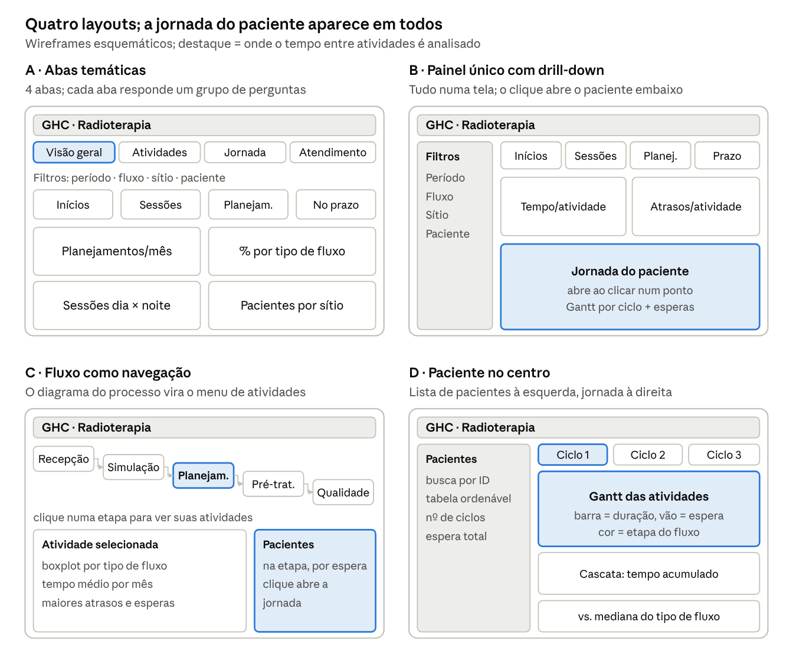

# Plano – Dashboard do Fluxo de Radioterapia (GHC)

Oct 30, 2026 · @Romulo

## Resumo

O dashboard será um app Plotly Dash com 4 abas, cujo centro é a **jornada de cada paciente**: cada paciente é dividido em um ou mais **ciclos de planejamento**, e cada ciclo mostra suas atividades em linha do tempo, com a duração de cada uma e a espera entre elas. As outras abas agregam esses mesmos dados em indicadores mensais (formato GHC), estatísticas por atividade e qualidade do atendimento diário.

Público: gestão e equipe da Radioterapia do GHC (SUS). Período coberto pelos dados: janeiro a agosto de 2026.

Objetivos:

1. Reproduzir os 16 indicadores da apresentação de junho/2026 e o formato resumido de agosto/2026.
2. Responder às 10 perguntas de negócio de `PerguntasNegocio.txt`.
3. Permitir seguir o fluxo de planejamento de cada paciente, com tempos entre atividades como informação principal.
4. Ser interativo em todas as telas: um clique em um gráfico filtra os demais.

## Dados e modelo

As duas planilhas são exportações do sistema Aria e se ligam pelo ID do paciente: 580 dos 581 pacientes de Consultas aparecem também em Tarefas.

| Planilha | Conteúdo | Linhas | Pacientes | Colunas-chave |
| --- | --- | --- | --- | --- |
| Tarefas RT (aba 2) | Atividades do fluxo (Recepção, Simulação, Planejamento, Pré-tratamento, CQ, Gestão, Revisão) | 21.238 | 683 | Atividade, Categoria, Status, Usuário, Vencimento, Início, Término, Tempo após vencimento, Duração real |
| Consultas AL (aba 2) | Agendamentos no acelerador linear: sessões por sítio, início e alta, CQ | 8.089 | 581 | Atividade (sítio), Agendado (SC), Check-in (CK), Início (ST), Término (ET), Duração, SC–CK, CK–ST |

**Limpeza necessária (camada ETL):**

- O cabeçalho real está na linha 13 (Tarefas) e 9 (Consultas); as últimas linhas trazem totais (Máx, Média, DEV STD) e devem ser descartadas.
- Nomes de colunas têm espaços sobrando (` Atividade  `, ` Data  `).
- 1.161 tarefas canceladas não têm início nem término; entram só como contagem de cancelamentos.
- Muitas tarefas têm duração 0 (são “marcadas” no sistema). Para elas o tempo útil é a espera até a conclusão, não a duração.
- O nome da atividade carrega o tipo de fluxo (`Contorno do PTV Eletivo`, `Aprovação Urgência`). Separamos em **atividade genérica** + **tipo de fluxo** (Eletivo, Prioridade, Urgência, Braquiterapia, Retomografado).
- Em Consultas, ` Internado -  ` vira uma coluna booleana e o sítio fica limpo.

**Modelo em três níveis: Paciente → Ciclo de planejamento → Atividade.**

Um novo ciclo começa a cada `Importar TC e Fusao` (ou `Importar Radiografia` na braquiterapia) concluído. Testei a regra nos dados: ela gera 715 ciclos, e 59 pacientes têm 2 ou 3 ciclos (replanejamento, nova TC, braquiterapia).

| Tipo de fluxo | Ciclos | Mediana Importar TC → última atividade (dias) | Prazo do sistema |
| --- | --- | --- | --- |
| Eletivo | 394 | 8,4 | 10 dias úteis |
| Prioridade | 137 | 4,8 | 5 dias úteis |
| Urgência | 48 | 1,8 | 1 dia útil |
| Braquiterapia | 86 | 2,0 | – |
| Retomografado | 42 | 3,7 | – |

Dentro de cada ciclo, as atividades são ordenadas pelo início e calculamos, para cada uma: **espera** (início desta − término da anterior), **duração** (término − início), **atraso** (término − vencimento) e **tempo acumulado desde Importar TC**. Espera negativa indica atividades em paralelo (ex.: Contorno de OAR e de PTV) e é mostrada como sobreposição, não como zero.

O ciclo também é ligado a Consultas: a primeira sessão `Início do Tratamento` após o fim do ciclo fecha o tempo **planejamento → início do tratamento**.

## Indicadores

São 27 indicadores em quatro grupos. Os de junho (J) mantêm o conteúdo integral; os de agosto (A) são os 5 do formato resumido, que viram cartões e gráficos da aba Visão Geral; as perguntas de negócio (P) e o fluxo por paciente (F) usam os cálculos do modelo acima.

A coluna **Fonte** diz se o indicador sai das planilhas ou precisa de dado externo (capacidade de máquina, dias prescritos), que fica num arquivo `config/metas.yaml` editável.

| # | Indicador | Origem | Fonte | Gráfico |
| --- | --- | --- | --- | --- |
| 1 | Pacientes (sítios) que iniciaram tratamento por mês | J, A | Consultas: `Início do Tratamento` | Linha + média 6 meses |
| 2 | Número de sessões de RT por mês | J, A | Consultas: sessões por sítio | Linha |
| 3 | Sessões dia × noite | J, A | Consultas: hora do agendamento (corte 18h, configurável) | Barras empilhadas |
| 4 | Taxa de ocupação do acelerador linear (meta 80–85%) | J | Consultas (minutos usados) ÷ capacidade (config) | Linha + faixa da meta |
| 5 | Taxa de ocupação do tomógrafo (meta 80–85%) | J | Externo (agenda do TC) | Linha + faixa da meta |
| 6 | Ocupação do tomógrafo: pacientes únicos | J | Tarefas: `Importar TC e Fusao` (proxy) | Linha |
| 7 | Ocupação do tomógrafo: exames | J | Tarefas: `Importar TC e Fusao` (proxy) | Linha |
| 8 | Número de planejamentos por mês | J, A | Tarefas: ciclos concluídos | Linha |
| 9 | Número de inícios de RT por mês | J, A | Consultas | Linha |
| 10 | Pacientes tratados por sítio (mês) | J, A | Consultas: sítio da sessão | Barras horizontais ordenadas |
| 11 | Tabela de pacientes por sítio/CID | J | Externo (CID não está nas planilhas) | Tabela |
| 12 | Duração média da sessão (min) | J | Consultas: Duração (AD) | Linha |
| 13 | Número médio de dias de tratamento | J | Consultas: Início → Alta por paciente | Linha |
| 14 | Taxa de absenteísmo | J | Externo (faltas não aparecem; só sessões realizadas) | Linha |
| 15 | % de planejamentos Eletivo/Prioridade/Urgência | J, A | Tarefas: tipo de fluxo do ciclo | Barras 100% empilhadas |
| 16 | Nº de planejamentos por tipo de fluxo | J, A | Tarefas | Barras agrupadas |
| P1 | Evolução dos planejamentos concluídos em 2026 | P | = indicador 8 | (reaproveita) |
| P2 | Distribuição Urgência / Prioridade / Eletivo | P | = indicador 15 | (reaproveita) |
| P3 | Atividades com maior tempo de execução | P | Tarefas: duração + espera | Barras horizontais (mediana, P90) |
| P4 | Duração das atividades por tipo de fluxo | P | Tarefas | Boxplot por atividade, cor = fluxo |
| P5 | Atividades com maior variabilidade | P | Tarefas: coeficiente de variação e IQR | Boxplot ordenado por IQR |
| P6 | Tempo médio por atividade ao longo dos meses | P | Tarefas | Heatmap atividade × mês |
| P7 | % de tarefas concluídas no prazo | P | Tarefas: Tempo após vencimento ≤ 0 | KPI + linha mensal |
| P8 | Atividades com maiores atrasos | P | Tarefas: atraso > 0 | Barras (mediana do atraso, % atrasadas) |
| P9 | Espera check-in → início do atendimento | P | Consultas: CK e ST | Histograma + boxplot por hora |
| P10 | Duração média do atendimento por tipo/sítio | P | Consultas: Duração por sítio | Barras com intervalo |
| F | Jornada do paciente: ciclos, atividades, espera entre atividades, tempo total, tempo até o início do tratamento | Pedido | Tarefas + Consultas | Gantt + tabela + cascata de tempos |

Dois dados citados nas apresentações não estão nas planilhas: a agenda do tomógrafo (5) e as faltas (14). O CID (11) também não. Proposta: deixar esses cartões com o rótulo “fonte externa” e um leitor de CSV opcional, para não travar o resto.

## Interatividade

A regra central é **filtragem cruzada com estado único**: todos os filtros e cliques gravam num `dcc.Store` (paciente, ciclo, atividade, tipo de fluxo, período), e cada gráfico lê esse estado. Assim qualquer gráfico pode ser a porta de entrada para o paciente.

**Filtros globais (barra fixa no topo):** período (`RangeSlider` por mês), tipo de fluxo (Eletivo, Prioridade, Urgência, Braquiterapia, Retomografado), categoria da atividade, sítio, internado sim/não, e busca por ID do paciente com autocompletar. Um botão “Limpar” zera tudo.

**Ações por gráfico:**

| Onde | Ação | Efeito |
| --- | --- | --- |
| Cartões KPI | clique | aplica o filtro do cartão (ex.: “Urgências”) |
| Séries mensais | clique num mês | filtra todas as abas para aquele mês |
| Barras por atividade | clique | abre o boxplot daquela atividade e a lista de pacientes com maior espera |
| Boxplot / dispersão | clique num ponto | abre a jornada do paciente daquele ponto |
| Tabela de pacientes (`dash_ag_grid`) | ordenar, filtrar, selecionar linha | carrega a jornada do paciente |
| Gantt da jornada | seletor de ciclo; passar o mouse | mostra início, fim, duração, espera anterior, atraso e usuário |
| Heatmap atividade × mês | clique numa célula | filtra atividade + mês |

**Detalhes que tornam a análise mais rápida:**

- Alternar métrica (mediana / média / P90) e unidade (horas / dias úteis) nos gráficos de tempo.
- Comparar um paciente com a mediana do seu tipo de fluxo: a linha do paciente sobre a faixa P25–P75 do grupo.
- Marcar em vermelho as esperas acima do P90 da atividade, para achar gargalos de um paciente.
- Estado na URL (`dcc.Location`), para compartilhar o link de um paciente ou filtro.
- Exportar a tabela filtrada para CSV e o gráfico para PNG (botão nativo do Plotly).

## Cores

A moldura usa a identidade do GHC (verdes-petróleo do formato de agosto, medidos nos slides); os dados usam poucas cores com significado fixo, seguindo o material de aula: no máximo 5 a 8 categorias, sem arco-íris, cor só onde destaca algo.

| Papel | Cor | Hex | Uso |
| --- | --- | --- | --- |
| Moldura | Verde GHC escuro | `#004231` | Cabeçalho, abas ativas, títulos |
| Moldura | Petróleo GHC | `#006E77` | Barra de filtros, botões |
| Moldura | Verde-água GHC | `#7ABBB1` | Bordas, sublinhado da aba, faixa de meta |
| Fundo | Cinza muito claro | `#F4F6F6` | Fundo da página; cartões em branco `#FFFFFF` |
| Texto | Grafite | `#2B2B2B` / `#6B7280` | Texto principal / secundário, eixos |
| Fluxo | Eletivo | `#2F6EBA` (azul) | Mesmo azul dos slides de junho e agosto |
| Fluxo | Prioridade | `#E08A00` (laranja) | Laranja do formato de agosto |
| Fluxo | Urgência | `#C62828` (vermelho) | Vermelho do formato de agosto |
| Fluxo | Braquiterapia | `#7B5EA7` (roxo) | Só aparece quando o filtro inclui |
| Fluxo | Retomografado | `#8A9BA3` (cinza-azulado) | Ciclos de replanejamento |
| Estado | No prazo / atrasado | `#2E8B57` / `#C62828` + ícone | Sempre com ícone ou texto, não só cor |
| Escala | Sequencial | branco → `#006E77` | Heatmaps de tempo (uma matiz só) |
| Escala | Divergente | `#2E8B57` ← branco → `#C62828` | Atraso: adiantado × atrasado em torno de zero |

O tema é gerado num módulo `theme.py` (template Plotly + variáveis CSS), para que nenhum gráfico tenha cor escrita à mão. Antes de fechar, validamos contraste (texto ≥ 4,5:1) e simulação de daltonismo; a dupla verde/vermelho sempre vem com ícone, por isso.

## Layouts

Recomendo um híbrido: o esqueleto de abas do layout A, com a aba Atividades no formato C e a aba Jornada no formato D. Assim os indicadores mensais ficam fiéis às apresentações e o tempo entre atividades de cada paciente ganha uma tela inteira.



*(4 layouts · wireframes — ver o documento online)*

| Layout | Ponto forte | Limite | Melhor para |
| --- | --- | --- | --- |
| A · Abas temáticas | Organiza os 27 indicadores sem poluir; espelha as apresentações | Trocar de aba interrompe a ida do indicador ao paciente | Reunião mensal de indicadores |
| B · Painel único com drill-down | Tudo ligado numa tela, do KPI ao paciente | Denso; aperta em notebook | Análise rápida de gargalos |
| C · Fluxo como navegação | Usa o fluxo do PNG, que a equipe já conhece | Indicadores mensais precisam de outra tela | Estatística por atividade (P3–P8) |
| D · Paciente no centro | Atende diretamente ao pedido: esperas por paciente e por ciclo | Pouco para a gestão mensal | Acompanhamento diário de pacientes |

Uma quinta opção, **E · Modo apresentação**, cabe como botão na Visão Geral: rolagem vertical com o cabeçalho GHC 100% SUS e os 5 gráficos do formato de agosto, um por bloco, pronta para exportar em PDF.

Na recomendação, as abas ficam: **Visão Geral** (A + E), **Atividades** (C), **Jornada do Paciente** (D) e **Atendimento no AL** (P9, P10, duração de sessão, dia × noite).

## Arquitetura e próximos passos

O código segue camadas com dependência num só sentido: **dados → domínio → indicadores → visualização**. Nenhum callback do Dash lê Excel ou calcula tempo; ele só chama funções puras já testadas.

```
radioterapia-dashboard/
├── config/
│   ├── settings.yaml        # caminhos, corte dia/noite, capacidade do AL
│   └── metas.yaml           # metas e dados externos (TC, faltas)
├── data/raw/                # planilhas anonimizadas (versionadas)
├── data/processed/          # parquet gerado pelo ETL (ignorado: é recriado)
├── src/rt_dash/
│   ├── io/loaders.py        # lê xlsx, acha cabeçalho, remove rodapé
│   ├── io/schemas.py        # validação com pandera
│   ├── domain/activities.py # catálogo: atividade genérica, tipo de fluxo, etapa
│   ├── domain/cycles.py     # segmenta paciente → ciclos; espera/duração/atraso
│   ├── domain/treatment.py  # sessões, início, alta, CK→ST
│   ├── metrics/monthly.py   # indicadores 1–16
│   ├── metrics/activity.py  # perguntas P3–P8
│   ├── metrics/registry.py  # cada indicador = função registrada com nome e meta
│   ├── viz/theme.py         # paleta e template Plotly
│   ├── viz/figures.py       # fábrica de gráficos (recebe DataFrame, devolve Figure)
│   └── app/                 # Dash: layout.py, callbacks/, pages/ (uma por aba)
├── tests/                   # pytest com dados sintéticos pequenos
├── pyproject.toml
└── CLAUDE.md
```

**Princípios aplicados:**

- **Responsabilidade única e separação em camadas:** ETL, regras de negócio, métricas e tela não se misturam.
- **Aberto/fechado via registro de indicadores:** um indicador novo é uma função com decorador `@indicator(...)`; a tela o descobre sozinha.
- **Configuração fora do código:** metas, capacidade e cortes em YAML.
- **Contratos de dados:** schemas pandera falham cedo se a exportação do Aria mudar de formato.
- **Testes:** casos sintéticos para a segmentação de ciclos (1, 2 e 3 ciclos, tarefas canceladas, atividades paralelas) e para cada indicador.
- **Desempenho:** ETL roda uma vez e grava parquet; o app carrega em memória e usa cache.
- **Qualidade:** ruff, mypy, pre-commit; README e CLAUDE.md com convenções.

**Stack:** Python 3.11+, pandas, Plotly Dash, dash-bootstrap-components, dash-ag-grid, pandera, pyarrow, pytest.

**Próximos passos:**

1. Escolher o layout (abaixo).
2. ETL + modelo de ciclos com testes.
3. Aba Jornada do Paciente (prioridade, pelo seu pedido).
4. Abas de indicadores e estatísticas.
5. Revisão visual com o material de aula (Gestalt, proporção áurea, cores).

**Perguntas em aberto:**

- Capacidade diária do acelerador linear (minutos) para a taxa de ocupação?
- Corte de horário entre turno dia e noite (assumi 18h)?
- Há exportação de faltas e da agenda do tomógrafo?
